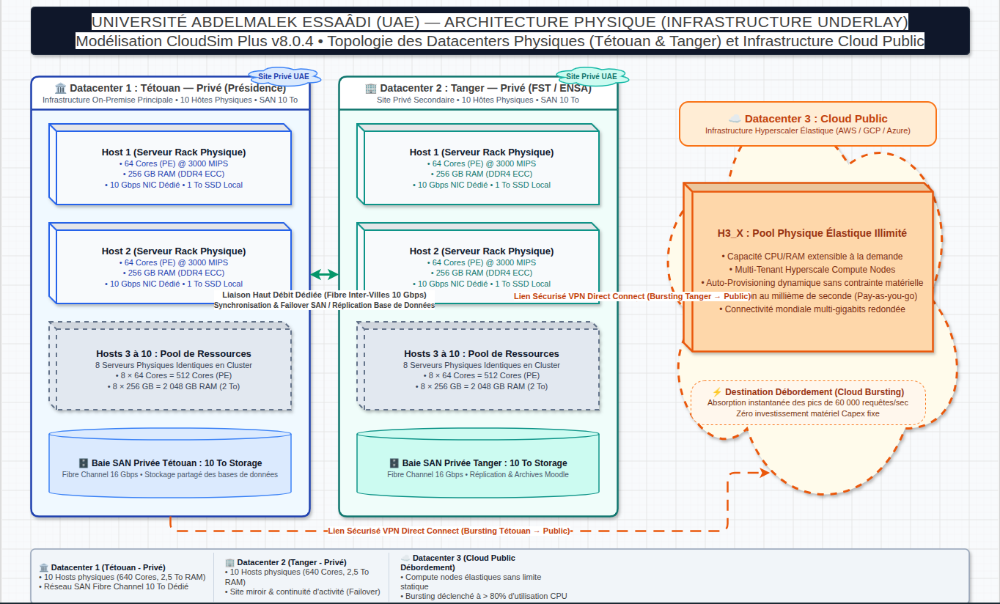
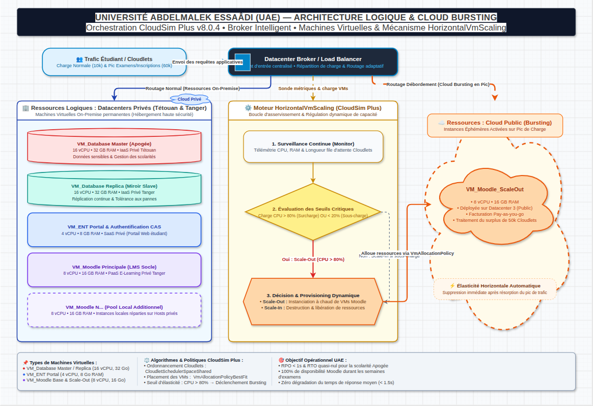

# Phase 1 & 2 : Recherche, Dimensionnement et Architecture Cloud de l'UAE

## 1. Contexte et Données Démographiques (Sources Officielles)
L'Université Abdelmalek Essaâdi (UAE) est une infrastructure universitaire majeure du nord du Maroc.
- **Étudiants :** ~123 000
- **Enseignants & Administratifs :** ~1 920
- **Établissements :** 15 (Tanger, Tétouan, Larache, Al Hoceïma, Ksar El-Kébir)

### Services Numériques Modélisés (SaaS/PaaS)
1. **Apogée (Inscriptions/Notes) :** Trafic critique (Pointe) en début/fin de semestre.
2. **Moodle (E-learning) :** Trafic lourd continu, pics sévères lors des examens.
3. **ENT & Webmail :** Trafic modéré et constant.

## 2. Architecture Physique (Infrastructure Underlay)
L'infrastructure physique (les `Host` dans CloudSim) est répartie sur trois sites. Un `Host` est un serveur physique massif capable d'héberger de multiples VMs.

- **Datacenter 1 (Privé - Tétouan) :** 10 Hosts (Capacité unitaire : 64 Cores PE, 256 Go RAM, 10 Gbps BW).
- **Datacenter 2 (Privé - Tanger) :** 10 Hosts (Capacité unitaire : 64 Cores PE, 256 Go RAM, 10 Gbps BW). Utilisé pour la haute disponibilité et la répartition de charge.
- **Datacenter 3 (Public - Cloud Bursting) :** Pool de ressources physiques élastiques (AWS/Azure) mobilisé uniquement à la demande.

### 2.1. Schéma d'Architecture Physique (Draw.io)
- **Fichier Draw.io :** [`diagrams/01_architecture_physique.drawio`](file:///home/yassine-kamouss/Bureau/partie01/diagrams/01_architecture_physique.drawio)

## 3. Architecture Logique et Virtualisation (Infrastructure Overlay)
Le dimensionnement des `Vm` est défini selon le service hébergé. Les VMs sont placées sur les Hosts via une politique d'allocation (ex: `VmAllocationPolicyBestFit`).

- **VM_Database (Apogée) :** 16 vCPU, 32 Go RAM. Déployée en Master (DC1) / Slave (DC2).
- **VM_Moodle (E-learning) :** 8 vCPU, 16 Go RAM. Multiples instances réparties sur les Hosts des DC1 et DC2.
- **VM_ENT (Portails) :** 4 vCPU, 8 Go RAM.

## 4. Orchestration et Mécanismes CloudSim Plus

### A. Gestion des requêtes (Cloudlets)
- **Période Normale (10k Cloudlets/sec) :** Utilisation de `CloudletSchedulerSpaceShared` (ou `TimeShared`) au sein des VMs pour gérer l'exécution des tâches assignées par le `DatacenterBroker`.

### B. Placement des VMs
- La politique `VmAllocationPolicyBestFit` est utilisée par les Datacenters pour trouver le Host ayant l'espace optimal (minimisation du gaspillage) pour démarrer une VM.

### C. Cloud Bursting (Auto-Scaling Dynamique)
Le mécanisme de débordement vers le DC3 ne se résume pas à "créer des VMs". Le cycle de vie (`HorizontalVmScaling`) est le suivant :
1. **Monitoring :** Surveillance continue de l'utilisation CPU/RAM des VM_Moodle.
2. **Seuil (Threshold) :** Détection de la saturation (ex: > 80% d'utilisation CPU moyenne).
3. **Scaling-Out :** Le `DatacenterBroker` instancie de nouvelles VM_Moodle dans le Datacenter 3 (Public).
4. **Routage :** Le load balancer redirige une partie des nouveaux Cloudlets vers ces instances publiques.
5. **Scaling-In :** Destruction des VMs publiques lorsque la charge globale redescend sous le seuil critique (optimisation des coûts).

### D. Schéma d'Architecture Logique, Orchestration & Bursting (Draw.io)
- **Fichier Draw.io :** [`diagrams/02_architecture_logique_bursting.drawio`](file:///home/yassine-kamouss/Bureau/partie01/diagrams/02_architecture_logique_bursting.drawio)

